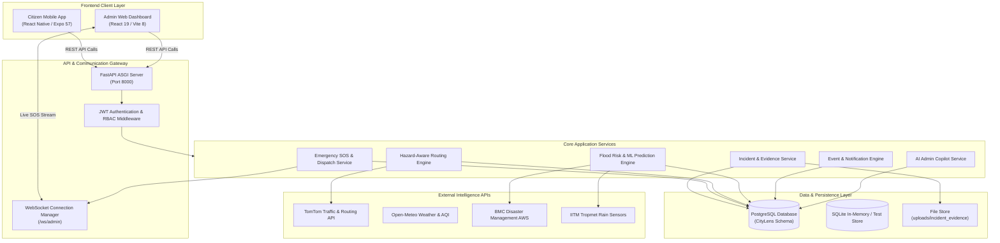
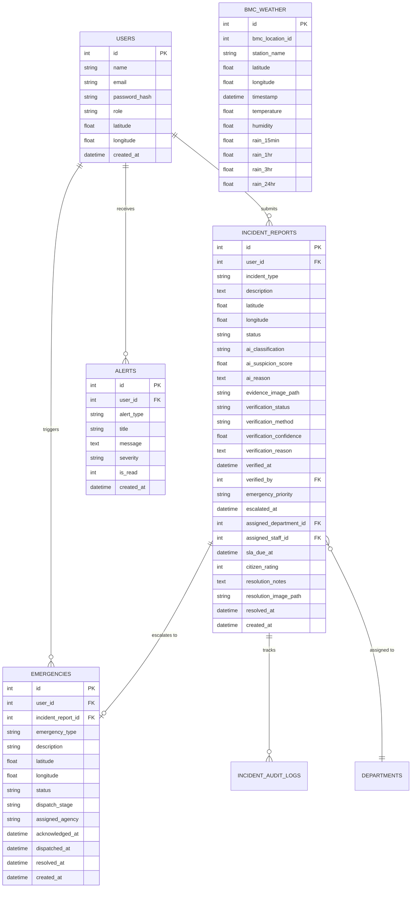
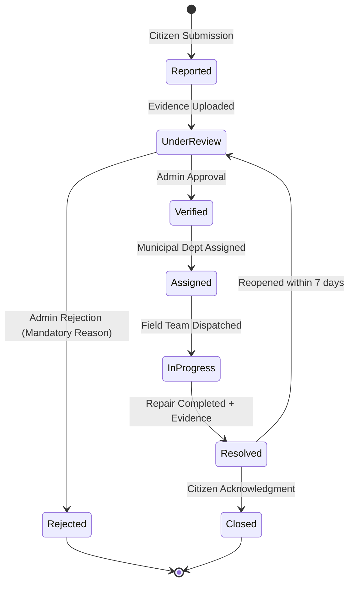
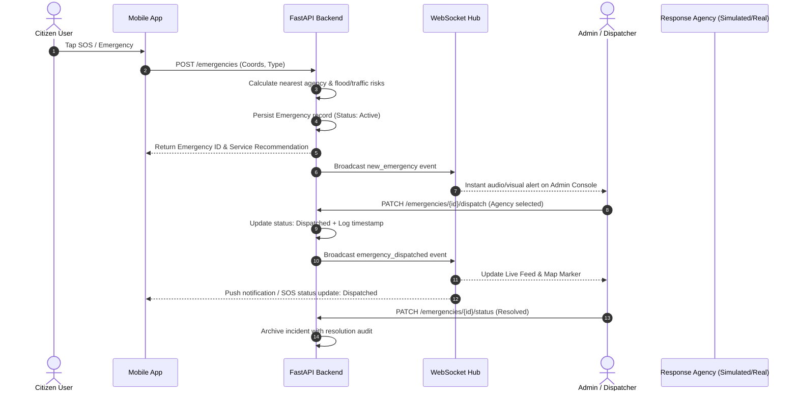

# CityLens AI — System Architecture & Data Flow

This document details the software architecture, data pipelines, network boundaries, and database design of CityLens AI.

---

## 1. System Overview & Component Diagram

---

## 2. Database Entity-Relationship Model

---

## 3. Incident Lifecycle State Machine

---

## 4. Emergency SOS Event & Broadcast Flow

