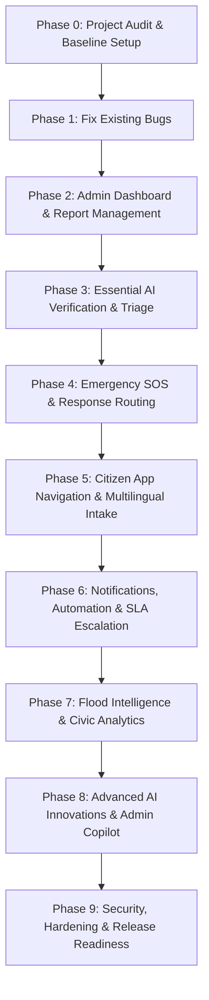

# CityLens AI — Master Project Implementation Roadmap

This document outlines the systematic, phased implementation strategy for transforming CityLens AI into a complete, reliable, intelligent urban civic management and emergency coordination platform.

---

## Phase Overview

---

## Detailed Roadmap Phases

### Phase 0: Baseline Audit & Documentation (Completed)
- [x] Complete code inventory across backend, admin dashboard, and citizen app.
- [x] Identify technology stack, dependencies, runtime constraints, and database models.
- [x] Produce `docs/PROJECT_AUDIT.md`, `docs/MASTER_ROADMAP.md`, `docs/FEATURE_STATUS.md`, `docs/ARCHITECTURE.md`, `docs/API_AND_INTEGRATIONS.md`, `docs/TEST_PLAN.md`, and `docs/IMPLEMENTATION_LOG.md`.

### Phase 1: Fix Existing Bugs
- [ ] **1.1 Fix Report Evidence Image Upload & Display**:
  - Broaden backend image MIME type support (`image/jpeg`, `image/jpg`, `image/png`, `image/webp`).
  - Add signature validation and defensive filename normalization.
  - Implement authenticated evidence streaming with URL fallback or base64 preview for admin and citizen apps.
  - Fix citizen app `uploadIncidentEvidence` to properly propagate upload failures and handle React Native `FormData`.
  - Add thumbnail / preview column to Admin Reports table and Review Queue.
- [ ] **1.2 Fix Visualizations / Charts Showing Unavailable Data**:
  - Implement functional card and chart components for `FloodRiskCard.tsx`, `WeatherCard.tsx`, `AQICard.tsx`, and `TrafficCard.tsx`.
  - Add data visualizations to Admin Dashboard (category distribution, resolution timelines, flood trends).
  - Refine `flood_risk_service.py` to differentiate between:
    - `FRESH` (live readings < 30m)
    - `RECENT` (readings 30m - 3h with explicit freshness indicator)
    - `HISTORICAL_BASELINE` (dry season / no recent precipitation)
    - `UNAVAILABLE` (station outage)
  - Ensure zero or missing values are never misrepresented as falsified numbers.
- [ ] **1.3 Fix Map Routing & Voice Messages**:
  - Correct rule in `backend/app/routes/routing.py`: when `flood_status == "NO_CURRENT_DATA"` but no flood hazard is present, evaluate overall risk from traffic, road closures, and emergency incidents rather than defaulting to `INSUFFICIENT_DATA`.
  - Update spoken guidance text and UI status pills to accurately reflect computed risk factors.
- [ ] **1.4 Baseline Regression Verification**:
  - Add database resilience so backend functions seamlessly in test/dev environments without crashing at import time.
  - Run and verify all pytest test suites.

### Phase 2: Admin Dashboard & Report Management
- [ ] **2.1 Comprehensive Review Queue**:
  - Evidence preview with zoom modal.
  - Search by description/id, filtering by category, status, priority, and date range.
  - Mandatory recorded rejection reason with administrative audit log.
- [ ] **2.2 Report Lifecycle & Auditing**:
  - Strict transition state machine: `Submitted -> Under Review -> Verified / Rejected -> Assigned -> Action in Progress -> Resolved -> Closed`.
  - Support reopening with recorded justification.
- [ ] **2.3 Dashboard Analytics**:
  - Real backend-aggregated metric endpoints for total complaints, resolution time distributions, ward breakdown, and emergency counts.
- [ ] **2.4 Department & Staff Workload Management**:
  - Department schema (Roads, Solid Waste, Stormwater Drains, Traffic, Health).
  - Staff assignment and case reassignment with role-based permissions.

### Phase 3: Essential AI Features
- [ ] **3.1 AI Civic Image Verification**:
  - Vision assessment module to classify evidence relevance against claimed category (potholes, garbage, waterlogging, streetlights, broken infrastructure).
  - Detect blurry, corrupt, or invalid evidence.
- [ ] **3.2 Transparent Suspicion Scoring**:
  - Multi-signal scoring: text brevity, geographic anomaly, submission velocity, image duplicate flag.
  - Structured explanation dictionary for admin clarity.
- [ ] **3.3 Duplicate Detection & Incident Clustering**:
  - Spatio-temporal clustering algorithm (Haversine distance <= 150m, category match, time window <= 72h).
  - Suggest linking duplicate reports to a parent master incident.
- [ ] **3.4 AI Priority & Department Recommendation**:
  - Heuristic & model-based routing to appropriate municipal department based on category and severity.

### Phase 4: Emergency SOS & Multi-Agency Coordination
- [ ] **4.1 Emergency Intake & Immediate Acknowledgment**:
  - Rapid SOS endpoint with geolocation, callback number, and incident category.
  - Instant WebSocket broadcast to active dispatchers.
- [ ] **4.2 Service Directory & Agency Routing**:
  - Built-in Mumbai emergency service directory (Fire Stations, Police Stations, BMC Disaster Wards, Trauma Care Centers).
  - Proximity calculation and responder recommendation.
- [ ] **4.3 Emergency Lifecycle & Dispatch Tracking**:
  - Discrete states: `Received -> Validating -> Notified -> Acknowledged -> Dispatched -> Arrived -> Resolved`.
  - Audit trail of dispatch actions and responder timestamps.
- [ ] **4.4 Admin Emergency Console & Simulated Dispatch Mode**:
  - Clear emergency UI tab with incident priority sorting.
  - Simulation sandbox for drills without triggering external production webhooks.
- [ ] **4.5 Citizen Emergency Awareness**:
  - Real-time SOS tracker in citizen app showing response stage.

### Phase 5: Citizen App & Intelligent Navigation
- [ ] **5.1 Typed Destination Autocomplete & Landmark Search**:
  - Backend search endpoint connecting to TomTom Search / Geocoding or Mumbai landmark index.
  - Interactive search bar in `map.tsx` with instant selection and routing.
- [ ] **5.2 Incident-Aware Hazard Avoidance**:
  - Real-time hazard layer (active flooding, major road closures, verified accidents).
  - Route calculation with hazard avoidance flags and explanation.
- [ ] **5.3 Voice Guidance & Accessibility**:
  - Accurate spoken feedback matching route intelligence.
  - Accessible touch targets and contrast-compliant theme support.
- [ ] **5.4 Multilingual Civic Reporting**:
  - Multi-language support (English, Marathi, Hindi) for report submission and emergency instructions.

### Phase 6: Notifications, Automation & SLA Escalation
- [ ] **6.1 Event-Driven Notification Engine**:
  - In-app notification creation on submission, review decision, department assignment, and resolution.
- [ ] **6.2 Automated Assignment & SLA Escalation**:
  - Target resolution SLAs by category (e.g., Pothole: 48h, Waterlogging: 12h, Garbage: 24h).
  - Automated background job to flag overdue reports and escalate to supervisory administrators.
- [ ] **6.3 Citizen Resolution Feedback & Reopening**:
  - Citizen satisfaction rating (1-5 stars) and feedback notes.
  - Capability to reopen report within 7 days if issue persists.

### Phase 7: Flood Intelligence & Civic Analytics
- [ ] **7.1 BMC & IITM Ingestion Validation**:
  - Data hygiene check: timestamp freshness, null imputation, duplicate suppression.
- [ ] **7.2 Rule Engine & ML Prediction Pipeline**:
  - Robust rule engine evaluating 15m, 1h, 3h, and 24h rainfall totals.
  - Validated inference pipeline using `flood_model.joblib`.
- [ ] **7.3 Flood Alerts & Ward Hotspot Mapping**:
  - Automated alert trigger when risk exceeds Moderate/High threshold.
  - Ward-wise flood vulnerability indexing.

### Phase 8: Advanced AI Innovations
- [ ] **8.1 AI Admin Copilot**:
  - Secure conversational query interface answering operational questions based on real database records.
- [ ] **8.2 Predictive Maintenance & Problem Clustering**:
  - Chronic hotspot detection (identifying intersections with recurring drain blockages or road damage).
- [ ] **8.3 Automated Daily Operational Summaries**:
  - Scheduled briefing generation summarizing 24-hour intake, resolution rates, and open emergencies.

### Phase 9: Security, Testing & Release Readiness
- [ ] **9.1 Authentication & Authorization Verification**:
  - RBAC verification on all endpoints.
  - Data privacy: anonymize citizen personal phone/email on public-facing endpoints.
- [ ] **9.2 Comprehensive Automated Testing**:
  - Unit tests for all business logic and AI modules.
  - API integration tests across complete complaint and SOS lifecycles.
  - End-to-end automated workflow verification (Workflows A through F).
- [ ] **9.3 Production Configuration & Runbooks**:
  - `.env.example` completeness, migration scripts, and runbook documentation.
