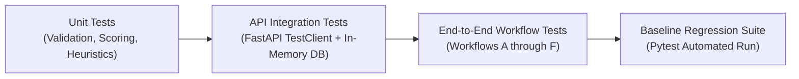

# CityLens AI — Master Test Plan

This document details the testing strategy, test suites, acceptance criteria, and execution procedures for verifying all capabilities of CityLens AI.

---

## 1. Test Levels & Strategy



1. **Unit Tests**:
   - Model validation, Pydantic schemas, password hashing, and token validation.
   - Anomaly detection (`IsolationForest`), heuristic image assessment, duplicate clustering.
   - Traffic congestion calculation and flood risk scoring logic.
2. **API & Integration Tests**:
   - Authentication flow (registration, login, invalid credentials, role restrictions).
   - Report creation, image upload with various MIME types and extensions, review decision with mandatory reason.
   - Emergency creation, WebSocket broadcast, and state transitions.
   - Routing analysis and destination search.
3. **End-to-End Workflow Verification**:
   - **Workflow A (Civic Report)**: Citizen submits report + photo -> AI assesses -> Admin reviews/approves -> Assignment -> Resolution -> Citizen feedback.
   - **Workflow B (Emergency SOS)**: Citizen triggers SOS -> Backend validates & acknowledges -> Admin alerted over WebSocket -> Agency selected & dispatched -> Resolution recorded.
   - **Workflow C (Navigation)**: Citizen searches destination -> TomTom route generated -> Hazards evaluated -> Spoken feedback & map display confirmed consistent.
   - **Workflow D (Flood Intelligence)**: Rainfall observations processed -> Rule engine calculates score -> Alert generated for high risk.
   - **Workflow E (Automation & SLA)**: Overdue report triggers escalation notification.
   - **Workflow F (AI Admin Copilot)**: Admin queries copilot -> Real database aggregated response generated.

---

## 2. Test Execution Commands

```bash
# Backend pytest suite (using project venv)
backend\venv\Scripts\python.exe -m pytest backend/tests -v

# Run with stdout printing for verification traces
backend\venv\Scripts\python.exe -m pytest backend/tests -v -s
```

---

## 3. Test Suites Inventory

| Test File | Focus Area | Covered Workflows |
| :--- | :--- | :--- |
| `backend/tests/test_complaint_lifecycle.py` | Complaint submission, evidence upload, admin review, state transitions | Workflow A |
| `backend/tests/test_emergency_dispatch.py` | Emergency SOS intake, service recommendations, dispatch lifecycle | Workflow B |
| `backend/tests/test_navigation_routing.py` | Routing hazard evaluation, search autocomplete, voice text consistency | Workflow C |
| `backend/tests/test_flood_intelligence.py` | BMC data processing, rule engine, ML forecasting, alert triggers | Workflow D |
| `backend/tests/test_automation_sla.py` | Category SLAs, overdue calculation, escalation alerts, feedback | Workflow E |
| `backend/tests/test_admin_copilot.py` | Copilot NL queries, ward aggregations, emergency summaries | Workflow F |
| `backend/tests/test_bug_fixes.py` | Regression verification for Bugs 4.1, 4.2, and 4.3 | All |
